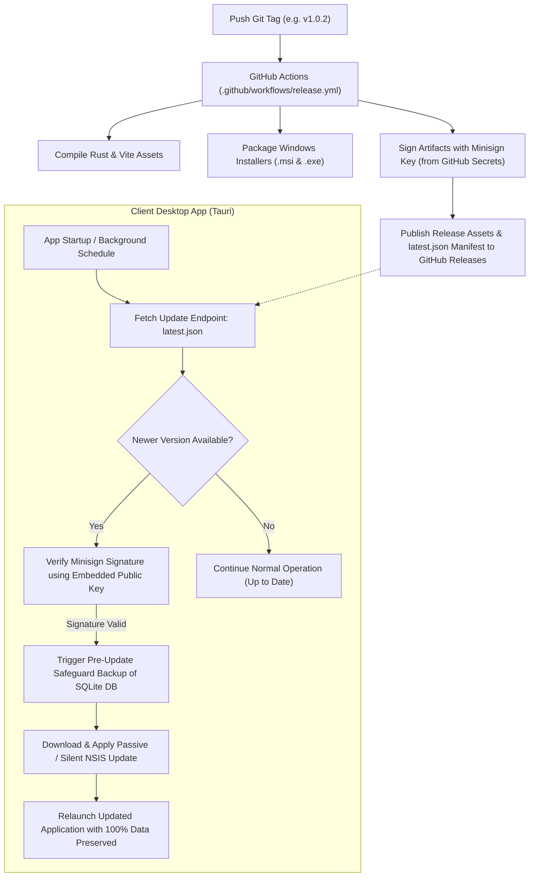

# MSS System — Shop Management System (نظام إدارة المحلين)

> Complete desktop application built with **Tauri v2 + React 19 + TypeScript + Tailwind CSS**, featuring an independent local **SQLite** database for accessories, and a shared cloud **Supabase PostgreSQL** database for laptops and monitors (MSS).

[](https://github.com/AhmedSaber45/MSS-System/actions/workflows/release.yml)
[](tests/)
[](https://v2.tauri.app/)
[](LICENSE)

---

## 🌟 Key Architecture & Highlights

- **Dual-Database Architecture (Rule 6):**
  - **Accessories Module:** 100% independent local SQLite database stored at `%APPDATA%\ShopManagementSystem\accessories.db`. Fast barcode POS, inventory, purchases, returns, and reports.
  - **MSS Module (Laptops & Monitors):** Centralized cloud Supabase PostgreSQL database shared between Shop 1 and Shop 2.
- **Offline-First Synchronization (Phase 09):**
  - Full local operation outbox with stable UUID v4 idempotency.
  - Automatic background synchronization upon reconnection.
  - Transparent `DOUBLE_SALE` conflict detection and preservation with manual resolution workflow (Rule 10 & 25).
- **Physical Device Tracking by Unique Serial (Phase 07):**
  - Track individual laptops and monitors with unique serial numbers, physical conditions, locations, and inter-branch transfers.
- **Cross-Branch Commercial Operations (Phase 08):**
  - Shop 1 can sell units physically stored in Shop 2 with automated location stock deduction and operational sales attribution.
  - Strict Rule 16 compliance: MSS gross profit is shared at the whole-business level and never attributed individually to the executing shop.
- **Executive Dashboard & Reports (Phase 10):**
  - Unified KPIs, date-range filtering, and distinct financial breakdown (Accessories vs MSS vs Combined).
- **Signed Tauri Updates & Windows Installer (Phase 11):**
  - Minisign signed releases via GitHub Releases with automated pre-update data safeguard backups.
  - NSIS and MSI installers targeting Windows currentUser.

---

## 🚀 Quick Start

### 1. Prerequisites
- Node.js 20+ (Node.js 22+ recommended)
- Rust (Cargo) & MSVC Build Tools (for desktop Tauri builds)
- Git

### 2. Installation
```bash
git clone https://github.com/AhmedSaber45/MSS-System.git
cd MSS-System
npm install
```

### 3. Environment Setup
Copy the example environment file:
```bash
cp .env.example .env
```
Configure your Supabase credentials:
```env
VITE_SUPABASE_URL=https://your-project-ref.supabase.co
VITE_SUPABASE_ANON_KEY=your-anon-key
```

### 4. Supabase Database Schema
Execute the consolidated migration in your Supabase SQL Editor:
- File path: `supabase/migrations/master_consolidated_mss_schema.sql`

### 5. Running Development
```bash
# Frontend development
npm run dev

# Full Tauri Desktop application
npm run tauri:dev
```

### 6. Running Test Suites
```bash
# Run all 120 automated verification tests
node --experimental-strip-types --test --test-concurrency=1 tests/products.test.mjs tests/purchases_inventory.test.mjs tests/sales_invoices.test.mjs tests/returns_reports_backup.test.mjs tests/mss_catalog.test.mjs tests/mss_inventory.test.mjs tests/mss_sales_reservations_returns.test.mjs tests/mss_offline_sync.test.mjs tests/unified_dashboard_reports.test.mjs tests/updater_release.test.mjs tests/final_qa_security_reliability.test.mjs
```

### 7. Building for Production
```bash
npm run build
npm run tauri:build
```

---

## 📦 Release Management & Automatic Updates

This section explains how to manage official application releases, monitor automated builds via GitHub Actions, publish signed Windows installers, and distribute seamless over-the-air updates to installed client applications.

### 1. GitHub Links & Resources

Quick access to project repositories, continuous integration pipelines, and release assets:

| Resource | Description | Direct Link |
|---|---|---|
| **GitHub Repository** | Main project codebase and branches | [AhmedSaber45/MSS-System](https://github.com/AhmedSaber45/MSS-System) |
| **GitHub Actions** | CI/CD build status, workflow logs, and pipeline runs | [Actions / Build Status](https://github.com/AhmedSaber45/MSS-System/actions) |
| **GitHub Releases** | Download latest official releases, installers, and release notes | [Releases / Download Latest Version](https://github.com/AhmedSaber45/MSS-System/releases) |

---

### 2. Creating the First Release (`v1.0.0`)

The application's release pipeline is fully automated using GitHub Actions. Publishing a release requires tagging a specific commit and pushing that tag to GitHub.

#### Step-by-Step Instructions:
1. Open **PowerShell** (or your terminal of choice) in the project root directory:
   ```powershell
   cd c:\Users\Administrator\Desktop\System
   ```
2. Verify that you are on the `main` branch and that your working tree is clean:
   ```powershell
   git status
   ```
3. Create the initial release tag matching the version defined in `package.json` (`1.0.0`):
   ```powershell
   git tag v1.0.0
   ```
4. Push the tag to GitHub:
   ```powershell
   git push origin v1.0.0
   ```

> [!NOTE]
> Pushing any Git tag matching the pattern `v*` (e.g., `v1.0.0`, `v1.0.1`) automatically triggers the continuous delivery workflow defined in [`.github/workflows/release.yml`](.github/workflows/release.yml).

---

### 3. Monitoring the Build Pipeline

Once a release tag is pushed, the build process runs in the cloud on a GitHub-hosted Windows virtual machine.

1. Navigate to the [GitHub Actions Dashboard](https://github.com/AhmedSaber45/MSS-System/actions).
2. Click on the active workflow run labeled **"Release & Automatic Update Pipeline"**.
3. **Monitor Execution Status:**
   - 🟡 **Yellow circle:** Build is currently executing (setting up Node.js, compiling Rust, running test suites, packaging Tauri binaries).
   - 🟢 **Green checkmark:** Build and release completed successfully! The installers and update manifests are now published under [GitHub Releases](https://github.com/AhmedSaber45/MSS-System/releases).
   - 🔴 **Red cross:** Build failed.
4. **Inspecting Logs & Troubleshooting:**
   - If a build fails, click on the workflow run and select the **`release-windows`** job.
   - Expand the individual steps (e.g., `Run Test Verification Suite`, `Build Frontend Assets`, or `Build Tauri Desktop Package & Sign Release`) to review detailed error output and compiler logs.

---

### 4. Publishing Future Updates (Step-by-Step Workflow)

Follow this standardized 7-step procedure whenever you are ready to ship a new version (for example, version `1.0.2`):

1. **Implement Code Changes:** Develop your bug fixes, UI improvements, or new features.
2. **Test Locally:** Ensure all automated test suites pass and the frontend compiles cleanly:
   ```powershell
   npm run build
   node --experimental-strip-types --test tests/final_qa_security_reliability.test.mjs
   ```
3. **Commit the Changes:**
   ```powershell
   git add .
   git commit -m "feat: describe your changes"
   ```
4. **Push Changes to Main:**
   ```powershell
   git push origin main
   ```
5. **Update Version Numbers in Project Files:**
   Open the following files and bump the `"version"` field to your new release version (e.g., `"1.0.2"`):
   - [`package.json`](package.json) ➔ `"version": "1.0.2"`
   - [`src-tauri/tauri.conf.json`](src-tauri/tauri.conf.json) ➔ `"version": "1.0.2"`
   - Commit this version bump:
     ```powershell
     git add package.json src-tauri/tauri.conf.json
     git commit -m "chore: bump version to 1.0.2"
     git push origin main
     ```
6. **Create the New Version Tag:**
   ```powershell
   git tag v1.0.2
   ```
7. **Push the Tag to Trigger Release:**
   ```powershell
   git push origin v1.0.2
   ```

#### Summary Command Example (v1.0.2):
```powershell
# 1. Commit and push code updates
git add .
git commit -m "feat: describe your changes"
git push origin main

# 2. Tag and publish release
git tag v1.0.2
git push origin v1.0.2
```

> [!IMPORTANT]
> **Strict Version Tag Matching Rule:**
> - The Git tag name (e.g., `v1.0.2`) **must strictly match** the version specified in `package.json` and `src-tauri/tauri.conf.json` (`1.0.2`).
> - **Do not blindly reuse an existing tag:** Git will reject pushing duplicate tags, and the Tauri updater will refuse to install an update whose version number is not strictly greater than the currently installed version.
> - Always use a new, unique semantic version (e.g., `v1.0.3`, `v1.1.0`).

---

### 5. Understanding the Automatic Update System

It is essential to understand how Tauri updates work and the difference between building an installer and publishing an automatic update.



#### Installer Build vs. Automatic Update Distribution
- **Building an Installer:** Generating an offline setup executable (`.exe` via NSIS or `.msi` via WiX). Users can run this installer manually to install or reinstall the software.
- **Publishing an Automatic Update:** An automated release pipeline that signs binary packages with a cryptographic signature, pairs each binary with a `.sig` signature file, and publishes an index file named **`latest.json`** on GitHub Releases.

#### The Update Cycle Explained:
1. **Cloud Build & Digital Signing:** When triggered, GitHub Actions builds the Windows installer and signs it with the private Minisign key securely stored in repository secrets.
2. **Metadata Generation (`latest.json`):** The release pipeline updates `latest.json` with the new version string, release notes, binary download URL, and cryptographic signature.
3. **Client Polling:** Installed applications query the configured update endpoint:
   `https://github.com/AhmedSaber45/MSS-System/releases/latest/download/latest.json`
4. **Cryptographic Signature Verification:** Before downloading, the Tauri updater validates the incoming update against the trusted public key stored in [`src-tauri/tauri.conf.json`](src-tauri/tauri.conf.json):
   ```json
   "plugins": {
     "updater": {
       "pubkey": "dW50cnVzdGVkIGNvbW1lbnQ6IG1pbmlzaWduIHB1YmxpYyBrZXk6IEE2QzkwNDczQkIzOUQ3NTYKUldSVzF6bTdjd1RKcG5GTnpqNnZHeUpsTXprMUJKcmJTN0UxTE1USU5RNzgxRzJaaTd3LzAyZDMK",
       "endpoints": [
         "https://github.com/AhmedSaber45/MSS-System/releases/latest/download/latest.json"
       ]
     }
   }
   ```
5. **Data Preservation & Safeguard Backup (Rule 22 & 23):**
   - The application automatically triggers a pre-update safeguard backup of the local SQLite database (`%APPDATA%\ShopManagementSystem\accessories.db`) before applying any update.
   - The installer installs in `currentUser` mode, replacing application binaries without touching user databases or backup files.

---

### 6. Important Security Notes & Best Practices

To maintain security and protect the business's data and infrastructure:

> [!CAUTION]
> **Critical Security Rules:**
> 1. **Never commit sensitive files to Git:**
>    - Ensure `.env` and any local configuration containing live database keys or API tokens remain in `.gitignore`.
>    - Never commit private signing keys (`.tauri/`, `*.key`, `*.pem`).
> 2. **Isolate Signing Keys in GitHub Secrets:**
>    - The updater signing private key (`TAURI_SIGNING_PRIVATE_KEY`) and password (`TAURI_SIGNING_PRIVATE_KEY_PASSWORD`) must reside exclusively in **GitHub Actions Secrets** (`Settings ➔ Secrets and variables ➔ Actions`).
>    - Never share or expose private keys in public repositories, pull requests, or issue trackers (Rule 21).
> 3. **Never Embed Access Tokens in Git URLs:**
>    - Always ensure your local Git remote URL does not contain personal access tokens (`ghp_...`):
>      ```powershell
>      # Verify your remote URL is clean:
>      git remote -v
>      # It should strictly display:
>      # origin  https://github.com/AhmedSaber45/MSS-System.git (fetch)
>      # origin  https://github.com/AhmedSaber45/MSS-System.git (push)
>      ```
> 4. **Supabase Key Isolation (Rule 20):**
>    - The client-side application only uses the public anonymous key (`anon_key`).
>    - The `service_role` key must **never** be included in frontend code, environment variables, or build assets.

---

---

## 🛡️ Compu MSS — Admin Dashboard (لوحة تحكم الإدارة المركزية المستقلة)

### 1. الوصف العام ومميزات اللوحة (Clear Description)
تم بناء **لوحة تحكم المسؤول (Compu MSS Admin Dashboard)** كتطبيق ويب مستقل مبني بأحدث تقنيات **Next.js 14 (App Router) + Tailwind CSS + Lucide Icons** ومستقر في المجلد `admin-dashboard/`. 

توفر اللوحة للإدارة وأصحاب العمل تحكماً مركزياً شاملاً يشمل:
- **إدارة مستخدمي تطبيق سطح المكتب (Desktop Users Management):** إنشاء وتعديل وتفعيل وتعطيل حسابات الموظفين والكاشير، وتعيين وتغيير رموز الدخول (`Access Codes`) المشفرة بـ `bcrypt`.
- **صلاحيات الأقسام المستقلة (Module Permissions):** تحديد وصول كل موظف بدقة (قسم الإكسسوارات فقط `accessories`، قسم الأجهزة فقط `mss`، أو كلا القسمين معاً `both`).
- **إدارة الفروع والمخازن والشركاء (Stores & Warehouses):** إدارة الفروع والمخازن ومقرات النشاط المشتركة، وتعيين الموظفين والشركاء للفروع، مع ميزة دمج الفروع الذرية دون تحريك المخزون.
- **تحويلات المخزون المركزية (Inventory Transfers):** مسار إرشادي ذري لنقل الأجهزة المسلسلة بين الفروع والمخازن مع الحفاظ المطلق على أسعار الشراء التاريخية وقانون حفظ المخزون (Rule C & D).
- **سجل التدقيق الإداري غير القابل للتعديل (Immutable Audit Logs):** توثيق كل حركة إدارية مع هوية المسؤول والتوقيت ولقطة البيانات.
- **عزل تام لقاعدة بيانات الإكسسوارات (Rule 6 Strict Isolation):** لا تتدخل اللوحة مطلقاً في قاعدة بيانات SQLite المحلية الخاصة بالإكسسوارات.

---

### 2. كيفية تسجيل الدخول بدون كتابة بريد إلكتروني أو كلمة مرور (Quick 1-Click Login)

تم تزويد شاشة تسجيل الدخول بخيار ذكي ومريح للغاية يتيح الدخول الفوري دون الحاجة لكتابة أو تذكر أي بيانات:

1. افتح صفحة تسجيل الدخول في المتصفح (`/login`).
2. ستجد زراً بارزاً أسفل نموذج الدخول:
   > **⚡ دخول سريع كمدير (بدون كتابة اسم المستخدم أو كلمة المرور)**
3. بمجرد النقر على هذا الزر، يقوم النظام تلقائياً بتعبئة بيانات المشرف الافتراضية المعتمدة وتسجيل الدخول فوراً والتحويل إلى اللوحة الرئيسية في أجزاء من الثانية!

> [!NOTE]
> **بيانات المدير الافتراضية (Default Admin Credentials):**
> في حال الرغبة في الكتابة اليدوية، البيانات الافتراضية هي:
> - **اسم المستخدم (Username):** `admin`
> - **كلمة المرور (Password):** `adminMSS@2026`

---

### 3. كيفية تشغيل وفتح لوحة الإدارة محلياً (How to Run Locally)

لتشغيل لوحة تحكم المسؤول على جهازك المحلي، اتبع الخطوات البسيطة التالية:

```bash
# 1. الدخول إلى مجلد لوحة الإدارة
cd admin-dashboard

# 2. تثبيت الحزم والمكتبات (إذا لم تكن مثبتة)
npm install

# 3. تشغيل خادم التطوير المحلي
npm run dev
```

بمجرد ظهور رسالة النجاح، افتح متصفح الإنترنت على الرابط:
👉 **`http://localhost:3000`**

- سيتم توجيهك تلقائياً لصفحة الدخول `http://localhost:3000/login`.
- انقر على **"دخول سريع كمدير"** للدخول فوراً للوحة.

---

### 4. كيفية نشر وتشغيل لوحة الإدارة سحابياً (How to Open Deployed on Vercel)

لوحة الإدارة مهيأة ومجهزة بنسبة 100% للنشر الفوري على منصة **Vercel** أو أي منصة استضافة سحابية تدعم Next.js:

#### خطوات النشر على Vercel:
1. ادخل إلى حسابك في [Vercel](https://vercel.com) وانقر على **Add New Project**.
2. اربط مستودع GitHub: `AhmedSaber45/MSS-System`.
3. في إعدادات المشروع (**Project Settings**):
   - حدد مجلد الجذر (**Root Directory**): اختر المجلد `admin-dashboard`.
   - اترك إعدادات البناء الافتراضية (Framework Preset: **Next.js**).
4. أضف متغيرات البيئة السرية في قسم (**Environment Variables**):
   ```env
   ```
5. انقر على **Deploy**.
6. عند اكتمال البناء (خلال دقيقة واحدة)، ستحصل على رابط رسمي مشفر (مثل: `https://compu-mss-admin.vercel.app`).
7. افتح الرابط في أي متصفح، وسجل الدخول بنقرة واحدة كمدير!

---

## 📖 Documentation
- [Setup and User Guide (دليل التثبيت والاستخدام الشامل)](docs/SETUP_AND_USER_GUIDE.md)
- [System Architecture Rules (قواعد البنية البرمجية)](rules.md)
- [System Specifications (مواصفات النظام الكاملة)](specifications.md)
